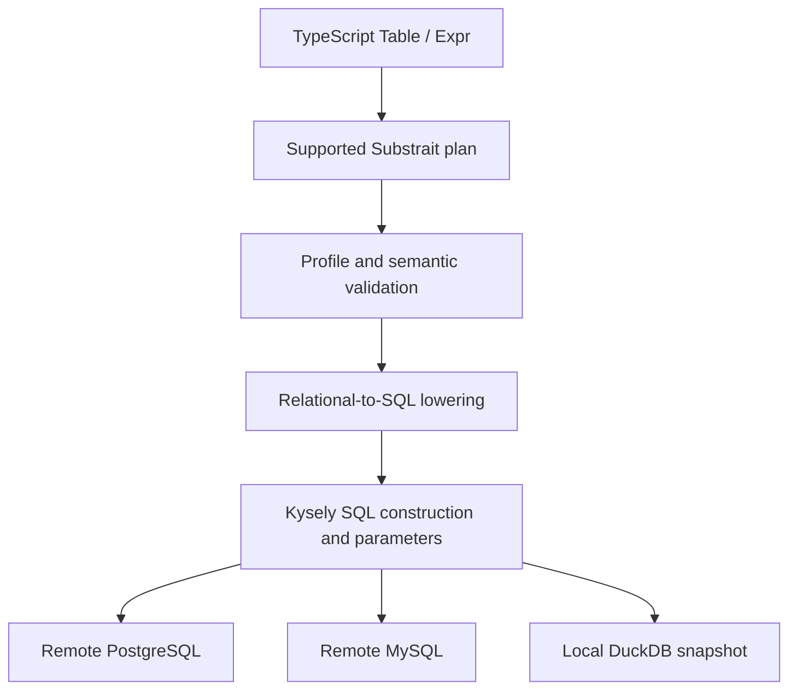

# Golden Analytics — AI README draft

> **AI-authored working draft, requested by the candidate on September 28, 2026.**
> This is supporting material, not the candidate-authored submission README required by the challenge. The candidate should check the claims, select the explanation they agree with, and write the final README in their own words. Actual time spent and the video link must be supplied by the candidate.

## What the project does

A small Node/TypeScript library expresses analytical queries independently of a relational database's SQL dialect. One logical query can execute on PostgreSQL, MySQL or DuckDB. It supports the six Northwind challenge query families, and demonstrates additional window ranking and a DuckDB backend.

PostgreSQL and MySQL execute queries remotely against the supplied `goldenbeers/golden-query-challenge:1.0` image. DuckDB executes the same query descriptions against a local snapshot copied from that image's PostgreSQL database. It is a separate execution target; no query is silently rerouted to DuckDB.

This draft reflects merged [typed API #22](https://github.com/poweihuang0817/GoldenAnalytics/pull/22) and [fresh-clone CI #23](https://github.com/poweihuang0817/GoldenAnalytics/pull/23), through main `5fc0b64`. Directory reorganization and compiler consolidation remain deferred. This is not a final submission tag.

## Quick start

Prerequisites: repository access, Node.js 22 or newer, npm, and Docker with Compose. Local verification used Node 24 on Windows. Use `npm.cmd` if PowerShell blocks `npm.ps1`.

```sh
git clone https://github.com/poweihuang0817/GoldenAnalytics.git
cd GoldenAnalytics
npm ci
docker compose up -d --wait
npm run check
npm run check:docs
npm test
npm run test:integration
npm run test:duckdb
npm run docs:examples
npm run demo
```

Ports 5432 and 3306 must be available. If the challenge container is already running on those ports, reuse it instead of starting another container. Compose corrects a PostgreSQL socket-path error in the image's default healthcheck.

The image's sample database/user/password are all `northwind`; the adapters default to localhost. Set `POSTGRES_URL` and `MYSQL_URL` for another instance. These defaults are sample-image credentials; actual deployment credentials should stay outside Git and the logical plan.

For the DuckDB extension:

```sh
npm run seed:duckdb
npm run demo:duckdb
```

The seed reads a consistent snapshot of four source tables and replaces those tables in a dedicated local `northwind.duckdb` file. Set `DUCKDB_PATH` to use another destination. Use a dedicated demo file; do not refresh it while another process owns it. Seeding needs PostgreSQL, while the seeded DuckDB demo runs independently afterward. See [DuckDB provenance and limits](docs/DUCKDB.md).

An optional walkthrough page is available:

```sh
node --import tsx src/playground/server.ts
```

Open `http://127.0.0.1:4317`. It shows three fixed API examples, compiled SQL, Substrait and real results for PostgreSQL/MySQL. The driver demonstrates the wider query set, including DuckDB and window ranking. The page is localhost-only; its HTTP input timeouts do not cancel database queries. See [demo-page notes](docs/DEMO-PAGE.md).

## Northwind data used throughout the examples

All application examples use the Northwind data from the supplied challenge image. The logical catalog exposes the columns needed for these queries:

| Table | Role in the examples |
| --- | --- |
| `customers` | Customer ID, city and country for customer counts and grouping |
| `orders` | Order ID/date, customer, employee, shipped date and freight |
| `order_details` | Order ID, unit price, quantity and discount for order totals |
| `employees` | Employee ID for shipped/unshipped order counts |

An order belongs to a customer and an employee; its detail rows describe purchased products and quantities. The catalog is a selected view of Northwind, not the complete physical schema. All six challenge families are implemented in [src/queries.ts](src/queries.ts).

## Public API: count Northwind customers in London

See the [API guide](docs/api/README.md) for the tutorial, reference, Northwind recipes and design tradeoffs.

The API borrows relational composition ideas from Ibis/Polars, predicate and projection objects from Drizzle, and schema-aware type ergonomics from Kysely. These are design references, not runtime dependencies beyond Kysely's existing SQL layer. This example can be placed in a TypeScript file at the repository root:

```ts
import { createSource, count, literal } from './src/api.js';
import { challengeCatalog } from './src/challenge.js';
import { createClient } from './src/client.js';

const source = createSource(challengeCatalog);
const customers = source.table('customers');
const predicate = customers.columns.city.lower().eq(literal('london').lower());
const london = customers.filter(predicate);
const query = london.aggregate({ customer_count: count() });

const client = createClient('postgres', challengeCatalog); // or 'mysql'; 'duckdb' after seeding
try {
  // Optional debugging; execute() also compiles the query itself.
  const preview = client.compile(query);
  console.log(preview.sql, { parameterCount: preview.parameters.length });
  const { rows } = await client.execute(query);
  console.log(rows); // Northwind: [{ customer_count: '6' }]
} finally {
  await client.destroy();
}
```

`source` captures a logical catalog, not a database connection. `Table` holds a relation description and output schema. `Expr` describes a column or calculation; `Measure` describes an aggregation. Transformations return new tables, allowing a base query to be reused without mutation.

`customers.columns.city` describes a column, not one row of fetched data. `filter` receives a predicate expression; `select` and `aggregate` receive named objects. Query-building callbacks are no longer accepted. Query construction performs no database I/O; `client.execute` performs filtering, joining and aggregation in the selected database.

Use the current relation's columns after each transformation. Runtime scope checks reject stale references even when two relations have the same TypeScript schema. A literal catalog enables compile-time field/kind checks and inferred result rows; a widened dynamic catalog cannot promise the same static precision.

Supported operations include projection, filters, inner/left joins, grouping and aggregation, ordering, pagination and a narrow `withRowNumber` operation. Joins explicitly name outputs and make the right side nullable for a left join. `count()` counts rows; `column.count()` counts non-null values. Counts/ranks are inferred as strings to preserve i64 precision; computed MySQL i32 values may also be strings, so i32 result types conservatively allow `number | string`.

## Query composition: average units per Northwind order

Average units per order requires two aggregation levels:

```ts
const details = source.table('order_details');
const units = details
  .groupBy('order_id')
  .aggregate({ units: details.columns.quantity.sum() });

const orders = source.table('orders');
const join = orders.join(units, { how: 'left' });
const matched = join.on(join.left.order_id.eq(join.right.order_id));
const perOrder = matched.select({ units: matched.right.units.coalesce(0) });
const query = perOrder.aggregate({ average_units: perOrder.columns.units.avg() });
```

For a concrete example, these three orders were read from the supplied Northwind PostgreSQL database:

| Northwind order ID | Detail quantities | Total units |
| --- | --- | ---: |
| 10248 | 12, 10, 5 | 27 |
| 10249 | 9, 40 | 49 |
| 10250 | 10, 35, 15 | 60 |

For this three-order subset, average units per order is `(27 + 49 + 60) / 3`, about 45.33. Averaging the eight detail quantities instead gives `136 / 8 = 17`, which answers a different question. These numbers illustrate the subset only; the API query above computes over all orders.

The compiler preserves the intermediate aggregation as a derived query. The left join also defines behavior for any order without details: it contributes zero units through `coalesce(0)`.

## Architecture and tradeoffs



- **Substrait:** official v0.63.0 protobuf schemas and generated codecs/types provide a standard representation. The public API constructs relations directly; export adds root names and function declarations. JSON plans can also round-trip through protobuf binary. Standard schema support and the supported execution subset are separate concerns.
- **Validation:** structural/profile checks reject unsupported fields and relations. Compiler checks resolve fields against the catalog and verify function signatures/types. A valid protobuf message is not automatically executable by this project.
- **Lowering:** the project handles relational semantics, subquery boundaries, explicit NULL ordering and necessary backend differences. An operator cannot always be appended to a single SQL SELECT block.
- **Kysely:** supplies SQL construction, quoting, bound values and execution infrastructure. Database-specific behavior such as exact DuckDB decimal division still requires project code.
- **Execution:** `createClient` owns the selected backend's resources. `execute(query)` compiles and executes the same logical query asynchronously; `compile(query)` provides an optional SQL preview. The application-facing client does not require calling Kysely directly.

Substrait is a relational IR, not the public semantic API. A future semantic frontend could resolve metrics, dimensions and grain into this supported profile. That frontend is not implemented, and Substrait does not supply connectors, federation or semantic modeling by itself. Retaining it has a cost: profile validation, function mappings and relational-to-SQL lowering remain project responsibilities.

The function registry uses Substrait's extension mechanism with an application-defined function library. It does not claim that those declarations are the upstream standard function library or that arbitrary Substrait plans are supported.

## Demonstration queries and semantics

See [src/queries.ts](src/queries.ts) for the application code and [src/demo.ts](src/demo.ts) for execution.

| Query | Important choice |
| --- | --- |
| Most recent N orders | Explicit NULL placement and order ID as a date tie-breaker |
| Customers in a city | Explicit lowercase comparison; no general Unicode/collation portability claim |
| Average units per order | Aggregate detail quantities per order first; empty orders count as zero |
| Shipped/unshipped per employee | Shipped-date nullness; include employees with no orders |
| Freight / order-price ratio per customer | Aggregate detail prices before joining freight; apply discounts; exclude freight from the price denominator |
| Country-level 75th percentile | Continuous linear interpolation, not an approximate percentile sketch |

The additional window feature ranks orders within each customer, then filters to the most recent N. It requires an outer relation after computing `row_number`; date ties are broken by order ID.

**DuckDB is the main submission extension:** it demonstrates adding a third execution backend while retaining the public API and plan. Its Node adapter binds parameters and preserves result representations. Snapshot provenance, exact decimal behavior and limitations are documented in [docs/DUCKDB.md](docs/DUCKDB.md).

## Verification and known limits

Verification evidence is tied to revisions, not just test counts. [Hosted run 36507131453](https://github.com/poweihuang0817/GoldenAnalytics/actions/runs/36507131453) passed at CI head `17d61a1`, incorporating typed-API main `fc5e1e4`. It used a fresh Ubuntu/Node 22 checkout and lockfile install, newly started supplied PostgreSQL/MySQL databases, and a separately seeded DuckDB file. All workflow steps passed, including driver and documentation-example execution. See [CI scope and evidence](docs/CI.md) and the [current workflow runs](https://github.com/poweihuang0817/GoldenAnalytics/actions/workflows/fresh-clone.yml).

An independent Windows clone also checked the merged typed API with `npm ci`: both code/docs typechecks, 35 local tests, 34 reported integration tests (including nested test containers), and one three-backend conformance test passed. The integration suite includes 15 fixture scenarios across PostgreSQL/MySQL/DuckDB in addition to Northwind cases. Counts are checkpoint evidence and will change as tests are added.

The Windows database checks used the existing supplied database instance; the hosted run independently verified fresh database startup. Neither is evidence for future unmerged changes. The final submission commit still needs its own green workflow. The optional page has HTTP tests; this draft does not claim a new browser visual review.

Tests use hand-calculated fixtures, independent raw-row/BigInt oracles, PostgreSQL's native percentile as an additional check, binary round trips and direct backend comparisons. Agreement between databases is useful but does not independently establish correctness. Regression tests caught a join-scope/nullability leak and DuckDB decimal-division precision errors before fixes.

Important limits:

- Decimals use decimal(38,10) and string results; i64 counts/ranks are strings and DATE values are calendar strings. Non-decimal arithmetic/averages may use fp64. Division by zero returns NULL. Overflow and precision limits remain explicit.
- DuckDB exact decimal AVG is rejected; the challenge's average-units query uses fp64. Exact decimal division is bounded by its HUGEINT intermediate.
- No general casts, arbitrary windows, distinct/union, correlated queries, cross-source federation or complete type system. Percentile must be the sole measure in its aggregate.
- Compile-time schemas do not prove SQL equivalence or replace runtime validation. Structural names must be known/narrowed for precise inferred outputs; relation-instance identity, numeric literal range and backend capability checks remain runtime concerns. Filters do not refine field nullability.
- Two compiler paths remain. Public API function declarations currently select the analytical path. Consolidation and declaration cleanup require compatibility decisions and regression tests; see [issue #7](https://github.com/poweihuang0817/GoldenAnalytics/issues/7).
- Production capability resolution, authentication/authorization infrastructure, normalized errors, cancellation, streaming and observability are deferred. The logical catalog is not an authorization boundary.

## AI assistance and candidate direction

The following summarizes recorded prompts/redirections, rather than reconstructing an exact chat transcript. See [docs/AI-LOG.md](docs/AI-LOG.md) for the development history.

| Candidate direction | Effect on the work |
| --- | --- |
| Start by checking the supplied Docker image | Verified access and data; corrected the Compose PostgreSQL healthcheck |
| Use an established relational representation | Selected a constrained Substrait profile with Kysely lowering |
| Use official Substrait definitions and reject unsupported features | Replaced handwritten standard-shaped types with generated upstream-schema types/codecs and explicit validation |
| Prove lower-layer coverage before adding the friendly API | Implemented analytical query composition, then the Ibis-inspired facade |
| Explain whether percentile interpolation is approximate | Clarified continuous percentile semantics and added exact decimal checks/oracles |
| Add a separate extension and then DuckDB for submission | Implemented row-number ranking and the third backend |
| Review incrementally and fix concrete findings | Added regression coverage, preserved working behavior and deferred compiler consolidation |
| Reconsider Kysely-only migration, then retain Substrait | Kept a relational IR boundary for a potential future semantic frontend, without claiming that frontend is implemented |
| Prefer typed predicates/projection objects and no callbacks | Added schema-aware fields, staged joins and result inference; migrated existing queries without changing their plans |
| Add tests before changing the API | Characterized NULLs, duplicate preservation, relation order and driver representations; fixed type-review findings with negative contracts |
| Verify fresh setup and submit early | Added hosted fresh-clone CI; deferred compiler refactors and prioritized candidate delivery materials |

AI assisted with research, implementation, tests, reviews and supporting documentation. Candidate decisions and redirects are recorded above. The candidate should write their own assessment of what was useful, what they challenged and what they would change. Actual work duration has not been recorded here and must not be inferred from the dates or original time-box expectation.

## With more time

1. Extend the existing NULL/duplicate/outer-join/nested-aggregate corpus with generated queries and shrinking, selected external conformance cases and independent oracles.
2. Introduce a small capability model with native/rewrite/unsupported outcomes that account for types and semantics.
3. Improve connection configuration, authentication/authorization boundaries and useful normalized errors, with secret redaction.
4. Consolidate compiler paths after defining compatibility; broaden supported types and clarify result normalization beyond the current conservative inference. Typed results and fresh-clone CI already exist.
5. Add cancellation, result limits, metadata discovery and structured diagnostics as real application requirements arise.

The broader [future-work notes](docs/FUTURE-WORK.md) preserve research into formal verification, additional engines and federation. Those are potential later directions, not completed work or submission commitments.

## Candidate completion checklist

- Write the final README in the candidate's own words; this file stays explicitly AI-authored.
- Record the five-minute walkthrough and add its accessible link.
- Enter actual time spent and check that the prompt/redirection account reflects the candidate's experience.
- Confirm reviewer access to the private repository and video.
- Select/tag the final delivery commit after submission documentation is complete.
