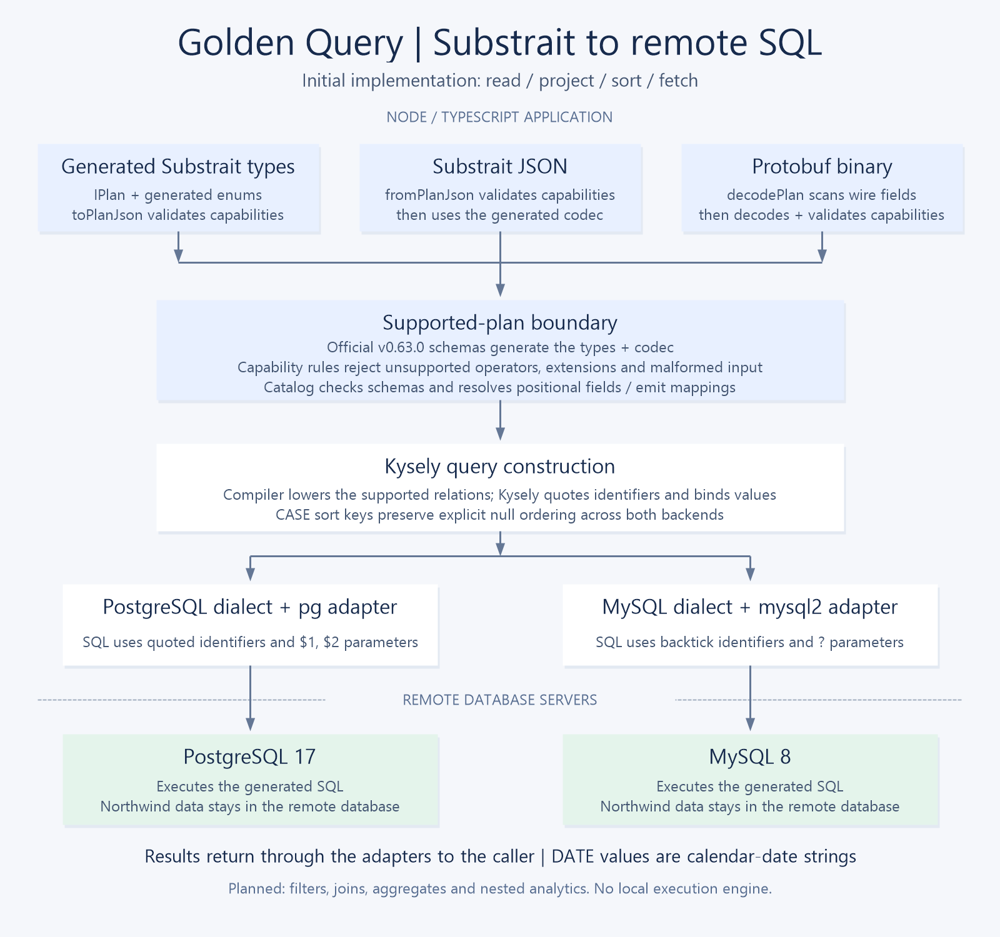

# Architecture decision: portable analytical query API

Status: ACCEPTED on September 26, 2026: a constrained Substrait profile compiled through Kysely, selected explicitly by the user. The lower layer now covers all six sample query families; see `CHALLENGE-COVERAGE.md` for semantics and evidence.



Diagram source: [`diagrams/render-architecture.ps1`](diagrams/render-architecture.ps1). Run it on Windows to regenerate the PNG.

## Retained IR checkpoint

The user has reaffirmed Substrait as the canonical relational IR, including as a target for a future semantic-query frontend. The current Table/Expr frontend and a future semantic frontend may both produce the supported relational profile; metrics, dimensions, grain and relationship resolution belong above this boundary. Substrait itself is not a semantic layer, connector system or execution engine.

Kysely remains internal SQL construction machinery. The earlier Kysely-only migration proposal is superseded. PR #17 API documentation and PR #18 createClient are merged; compile-time schema propagation and callback-free predicates are described in the [typed API contract](TYPED-RELATIONAL-API-PLAN.md). No semantic frontend, federation or compiler replacement is part of that work.

## Requirements

- Prefer Node.js/TypeScript.
- Express selection/projection, filtering, joins, aggregation, and calculations independently of the target database.
- Execute against the supplied PostgreSQL and MySQL databases.
- Extend the implementation and shared test harness to additional backends.
- Demonstrate one extension after the basic API works.
- Reuse established compiler machinery where practical.

The challenge does not explicitly require an HTTP service, serialized query format, SQL text input, optimizer, or execution engine. Those are separate scope decisions.

## Distinguish the representations

- SQL AST: clauses and expressions representing a SQL query.
- Logical relational algebra: reads, filters, joins, projections, aggregates, and sorts describing query semantics. This does not require prescribing physical execution algorithms.
- Physical plan: implementation choices such as join algorithms and execution scheduling, which remain the database's responsibility here.
- A library AST that can be serialized is not automatically an independent cross-language standard.

## Options researched

| Option | Strength | Cost or limitation here |
| --- | --- | --- |
| Kysely | TypeScript query builder with SQL operation nodes and PostgreSQL/MySQL dialect compilers | Library API, not a cross-language IR standard; semantic differences still need handling |
| Substrait | Open Protobuf interchange specification for relational algebra | Requires a supported conversion path to target SQL, schema/function handling, and a defined supported subset |
| DataFusion | SQL AST ecosystem, logical plans, native Protobuf serialization, Substrait conversion, and SQL unparser | Rust/Python integration adds scope; operator and function coverage must be tested |
| Malloy | BI semantic modeling/query language that compiles to backend SQL; query-builder package | Adopts Malloy's model and semantics; interface stability and required feature coverage need evaluation |
| Trino | SQL parser/AST and federated query engine | Java/engine integration; its client SQL interface is not a generic portable SQL AST contract |
| SQLGlot | SQL expression AST and dialect translation | Python dependency; serialized AST is library-specific |
| Apache Calcite | SQL AST, relational algebra, validation and compiler framework | JVM integration and substantial scope for this challenge |

Sources:

- https://kysely-org.github.io/kysely-apidoc/interfaces/Dialect.html
- https://substrait.io/spec/specification/
- https://github.com/apache/datafusion-sqlparser-rs
- https://datafusion.apache.org/python/autoapi/datafusion/substrait/index.html
- https://datafusion.apache.org/python/autoapi/datafusion/unparser/index.html
- https://github.com/malloydata/malloy
- https://github.com/malloydata/malloy/tree/main/packages/malloy-query-builder
- https://trino.io/docs/current/develop/client-protocol.html
- https://sqlglot.com/
- https://calcite.apache.org/javadocAggregate/org/apache/calcite/sql2rel/SqlToRelConverter.html

These are candidate capabilities, not verified compatibility with every challenge query. In particular, DataFusion's SQL unparser means a Substrait-to-SQL path is worth investigating rather than assuming an entire compiler must be written from scratch.

## Accepted challenge architecture

Application-facing refinement accepted September 26: a small Ibis-inspired immutable Table/Expression API produces the supported Substrait profile. Application code uses typed relation-scoped column expressions and projection objects rather than raw protobuf structures. Substrait remains the interchange contract; Kysely remains internal SQL machinery. See [public API and current limits](PUBLIC-API.md). Backend capabilities/errors/logging follow API coverage and further verification in separate work.

The current Table/Expr API is the application-facing frontend and lowers into the supported Substrait v0.63.0 profile. Substrait is the canonical relational contract between frontends and backend compilation, not the semantic model or required application-facing API. The compiler accepts the constrained Protobuf JSON representation, validates supported relations and resolves positional fields against a logical catalog, then lowers through Kysely for SQL construction. Keep backend connection/execution adapters separate. This is a relational translation layer, not a semantic modeling layer or local execution engine.

```text
Driver / application
    -> Table/Expr application-facing API
    -> supported Substrait relational IR (JSON profile)
    -> validation + catalog/positional field resolution
    -> selected backend adapter + Kysely dialect compiler
    -> SQL with bound parameters
    -> PostgreSQL / MySQL / DuckDB
    -> documented result normalization
```

Each backend supplies connection configuration, compiler/dialect, capabilities, execution, and shutdown. Unsupported operations fail explicitly. Query values are bound; identifiers come from typed/validated query structure. Raw SQL, if needed inside an adapter, uses trusted templates with bound values.

Substrait was chosen to retain an established relational representation rather than invent a new IR. Kysely supplies TypeScript-native SQL construction, quoting, and parameters. DataFusion would add a Rust/Python integration boundary; DuckDB federation could move computation into the application; Malloy introduces semantic modeling beyond this task. None is required for this implementation. PostgreSQL/MySQL perform all query execution.

## Semantics to define before implementing samples

- Recent orders: deterministic date ordering, tie-breaking by order ID, and explicit null ordering.
- City filter: define case matching explicitly; backend default collations differ.
- Units per order: average per-order quantity totals, not average line-item quantities; decide how empty orders count.
- Shipped versus unshipped: shipped-date nullness; include employees with zero orders.
- Freight ratio: aggregate freight once per order to avoid join multiplication; define whether price includes discount, and define zero-denominator behavior.
- Percentile: specify continuous or discrete, exact or approximate, and treatment of nulls. Verify backend support before choosing an implementation.
- Results: document decimal precision, count representation, dates, nulls, and comparison tolerances. Do not silently coerce all decimals to JavaScript numbers.

## Validation strategy

- Run shared integration cases against both provided databases through backend factories.
- Check independently calculated expected results or reference queries, not only backend agreement.
- Cover parameter binding, deterministic limits, null handling, aggregate grain, and zero denominators where fixtures allow.
- Use focused compiler checks for dialect-specific helpers; avoid tests that merely duplicate implementation.
- Close connections reliably; report unsupported capabilities clearly.

## Decisions pending

1. The high-level Table/Expr API is implemented over the validated lower layer. Filters, function anchors, inner/left joins, aggregates, CASE, and derived-table scopes cover the sample queries.
2. Broaden interoperability tests beyond the initial official-schema binary round trips. Generated types/codecs now come from the vendored v0.63.0 schemas; a separate capability validator rejects everything outside the implemented subset.
3. The separately demonstrated extension is portable row_number ranking for recent N orders per customer. See [implementation and tests](WINDOW-EXTENSION.md). DuckDB is an independently requested third-backend task (#12); it is not part of this window PR.

The initial profile and its limitations are documented in `SUBSTRAIT-PROFILE.md`. Acceptance of the architecture does not imply full Substrait support or a complete challenge submission.
