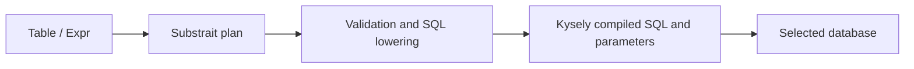

# Golden Analytics API documentation

This guide documents the Node/TypeScript library over the supplied Northwind data. It covers the current implementation: PostgreSQL, MySQL, DuckDB, the supported Substrait profile and the row-number extension. The package is currently private and imported from source, rather than published on npm.

## Choose a reading path

| Your question | Read |
| --- | --- |
| How do I write and run my first query? | [Northwind tutorial](tutorial.md) |
| Why typed Table/Expr instead of exposing Kysely or raw Substrait? | [Design explanation and tradeoffs](design.md#why-take-inspiration-from-ibis) |
| What methods, arguments and defaults exist? | [Source and Table reference](tables.md), [expressions and aggregates](expressions.md) |
| How do I compile, execute or serialize a query? | [Execution and errors](execution.md) |
| How do I express the challenge queries? | [Northwind recipes](northwind.md) |
| What are the NULL, decimal and ordering rules? | [Semantics and limitations](semantics.md) |
| How do we keep these docs accurate? | [Documentation maintenance](maintaining.md) |

Recommended first reading: tutorial -> design -> Northwind recipes. Use the reference pages as a lookup while writing queries.

## The execution path



Constructing a query does not fetch rows. `client.execute(query)` validates, compiles and executes it. Optional `await client.compile(query)` previews SQL and bound parameters. Advanced callers can still use `toSubstrait()`, `compilePlan()` and `db.executeQuery()` separately. PostgreSQL/MySQL run remotely. DuckDB runs against a separately seeded local file, with no automatic fallback or federation.

## Run the documented examples

From the repository root after `npm ci`:

```sh
npm run check:docs
npm run docs:examples
```

The first command type-checks the example source and imported library. The second compiles the documented queries for all three backends without querying a database. [examples.ts](examples.ts) is the runnable companion to the tutorial and recipes.

For actual results, start the supplied databases using the [setup instructions](../RUNNING.md), then:

```sh
npm run seed:duckdb
npm run docs:examples -- --execute
```

Execution needs both remote databases and the seeded DuckDB file. It runs only fixed read queries, prints a small result preview, and always releases connections. Seeding is a separate operation which replaces the four snapshot tables in the dedicated DuckDB destination; see [DuckDB setup](../DUCKDB.md).

## Import and source map

| Module | Application entry points |
| --- | --- |
| [src/api.ts](../../src/api.ts) | `createSource`, `Table`, `Expr`, `Measure`, `Sort`, `literal`, `integer`, `caseWhen`, `count`, `eq`, `and` |
| [src/client.ts](../../src/client.ts) | `createClient`, `QueryPreview`: execute, preview SQL and release resources |
| [src/compiler.ts](../../src/compiler.ts) | `compilePlan`, `Catalog`, `Database` |
| [src/backend.ts](../../src/backend.ts) | `connect`, `Backend` |
| [src/plan.ts](../../src/plan.ts) | `SupportedPlanJson`, `encodePlan`, `decodePlan`; lower-level profile/conversion utilities |
| [src/challenge.ts](../../src/challenge.ts) | `challengeCatalog` for Northwind |
| [src/queries.ts](../../src/queries.ts) | The six challenge query families and recent-orders-per-customer extension |

Use the exported builder functions; runtime constructors and expression resolution are internal plumbing. A literal catalog supplies compile-time field names, expression kinds, nullability and result-row inference. A dynamically widened `Catalog` loses that precision; runtime field/type/scope validation remains necessary. JSON/binary plans also require semantic compilation before execution.

There is no general HTTP query API. The optional [demo page](../DEMO-PAGE.md) has a fixed allowlist of examples and is a localhost walkthrough. Use this library interface for application queries.
